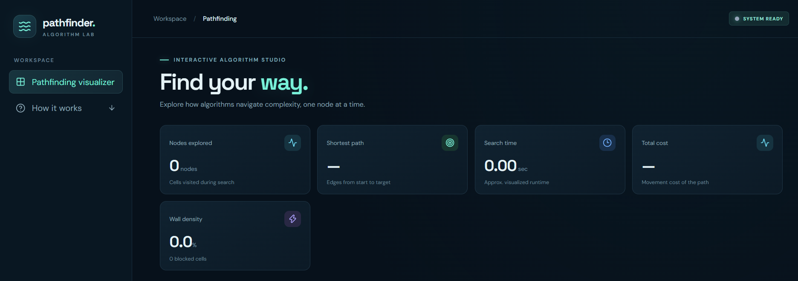
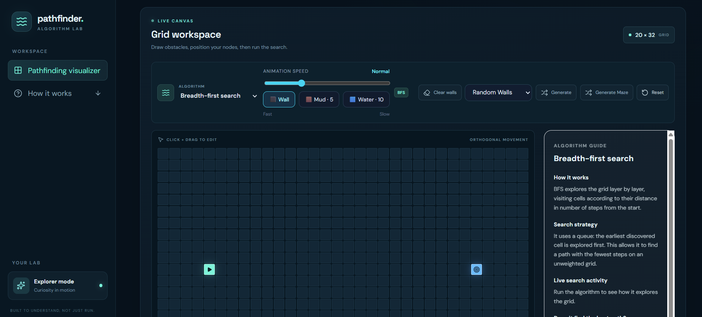

# pathfinder. — Algorithm Visualizer

An interactive pathfinding visualizer built with React and TypeScript. Explore how different pathfinding algorithms navigate a grid, handle obstacles, and find routes through weighted terrain.

## Overview

**pathfinder.** is an interactive educational application designed to demonstrate and compare classic pathfinding algorithms through real-time grid visualization.

Users can create obstacles, experiment with different terrain costs, move the starting and target nodes, and observe how each algorithm explores the search space.

The application also includes an algorithm guide that explains each algorithm's strategy and displays live search information during visualization.

## Features

- **Four pathfinding algorithms:** Breadth-First Search (BFS), Depth-First Search (DFS), Dijkstra's Algorithm, and A* Search.
- **Interactive grid:** Move the start and target nodes and draw obstacles directly on the grid.
- **Weighted terrain:** Experiment with normal cells, mud, and water, each with different movement costs.
- **Animated visualization:** Watch explored cells and the resulting path appear on the grid.
- **Algorithm comparison:** Compare the exploration results and path costs of all four algorithms.
- **Live algorithm guide:** View explanations, exploration statistics, and algorithm-specific search information.
- **Random challenges:** Generate random walls, terrain configurations, and mixed challenges.
- **Maze generation:** Create structured mazes to experiment with different search scenarios.

## Screenshots

### Main Interface





## Algorithms

| Algorithm | Search strategy | Optimality |
|---|---|---|
| BFS | Explores cells layer by layer | Fewest steps on an unweighted grid |
| DFS | Explores deeply before backtracking | Does not guarantee an optimal path |
| Dijkstra | Prioritises the lowest accumulated movement cost | Lowest-cost path |
| A* | Combines accumulated cost and estimated remaining distance | Lowest-cost path with the current heuristic |

### Weighted Terrain

The application supports different movement costs:

| Terrain | Movement cost |
|---|---:|
| Normal | 1 |
| Mud | 5 |
| Water | 10 |

BFS and DFS treat every move equally, while Dijkstra and A* account for terrain movement costs.

A* uses Manhattan distance as its heuristic to estimate the remaining distance to the target.

## Tech Stack

- React
- TypeScript
- Vite
- CSS
- Lucide React
- Vitest

## Getting Started

### Prerequisites

- Node.js
- npm

### Installation

Clone the repository:

```bash
git clone https://github.com/FarahHanim25/pathfinding-playground.git
```

Navigate into the project directory:

```bash
cd pathfinding-playground
```

Install dependencies:

```bash
npm install
```

Start the development server:

```bash
npm run dev
```

Open the local URL provided by Vite in your browser.

## Testing

Run the automated test suite:

```bash
npm run test -- --run
```

Run the production build:

```bash
npm run build
```

Run ESLint:

```bash
npm run lint
```

## Project Structure

```text
pathfinding-playground/
├── src/
│   ├── App.tsx
│   ├── index.css
│   ├── pathfinding.ts
│   ├── pathfinding.test.ts
│   └── algorithmExplanations.ts
├── public/
├── index.html
├── package.json
└── README.md
```

## Project Goals

This project explores how fundamental graph-search algorithms behave in different environments, with an emphasis on algorithm visualization, interactive experimentation, and understanding the trade-offs between search strategies.

---

**Built as a personal software engineering side project.**